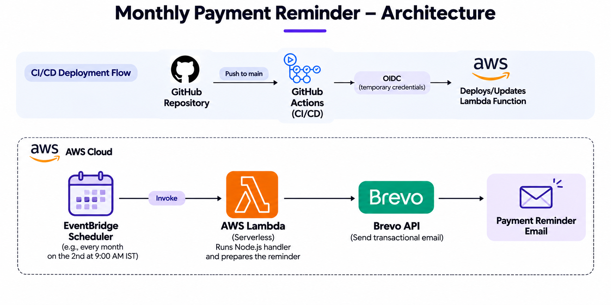

# Reminder Scheduling System

A serverless reminder scheduling system built with Node.js, AWS Lambda, Amazon EventBridge Scheduler, and Brevo. It automatically sends scheduled email reminders with payment links.

## Architecture



- **EventBridge Scheduler:** Triggers reminders based on a configured date and time.
- **AWS Lambda:** Executes the Node.js handler and processes recipients.
- **Brevo API:** Sends reminder emails.
- **GitHub Actions:** Automates deployment to AWS Lambda using OIDC authentication.

## Project Structure

```text
├── config/
│   └── env.config.js       # Application configuration
├── src/
│   ├── services/
│   │   └── brevo.js        # Brevo email integration
│   ├── utils/
│   │   └── upi.js          # UPI payment link generation
│   └── handler.js          # Lambda handler
├── test/
│   └── test.js             # Local execution test
├── .github/
│   └── workflows/
│       └── deploy.yml      # Automated AWS deployment
├── .env                    # Local environment variables
├── package.json            # Project metadata and dependencies
└── package-lock.json       # Locked dependency versions
```

## Setup

Install dependencies:

```bash
npm install
```

Configure the following environment variables in `.env`:

```env
BREVO_API_KEY=
BREVO_SENDER_EMAIL=
BREVO_SENDER_NAME=
UPI_ID=
RECIPIENTS_CONFIG=
```

Run locally:

```bash
node test/test.js
```

## Deployment

Push changes to the `main` branch. GitHub Actions authenticates with AWS using OIDC and automatically packages and deploys the application to Lambda.

AWS Lambda environment variables and EventBridge schedules are configured separately in AWS.